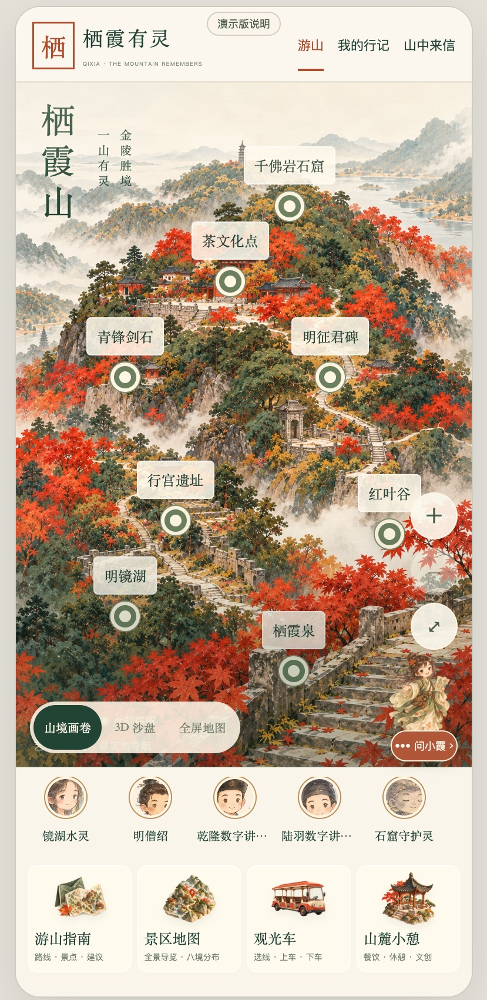
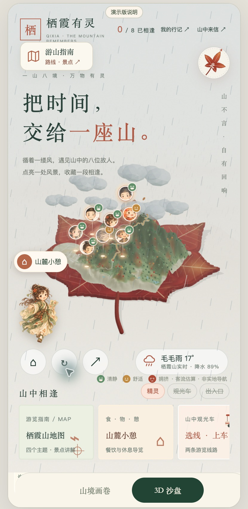
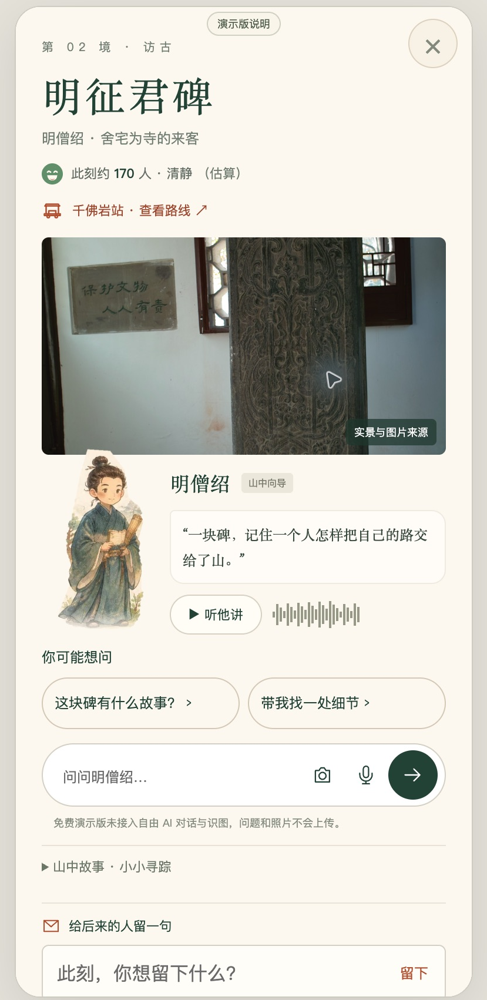

# 栖霞有灵 · Qixia Spirit

**把时间，交给一座山。**

栖霞有灵是一款面向手机浏览器的栖霞山文化探索产品原型。游客可以在秋日山境画卷和可旋转的 3D 沙盘之间切换，沿着八个景点认识历史人物与山中精灵，阅读文化故事、查看游山指南，并把旅途中的一句话收进个人行记。

[在线体验](https://123Daved.github.io/qixia-spirit/) · [产品 PRD](docs/PRD.md) · [部署与功能边界](docs/DEPLOYMENT.md) · [素材与来源](assets/模型来源与许可.md)

> 当前公开站点为免费静态演示版。无需安装应用，也无需登录即可浏览。免费域名在不同网络的可达性存在差异，不承诺中国大陆所有网络均可访问。

## 产品界面

| 山境画卷 | 3D 沙盘 |
| --- | --- |
|  |  |

*截图为当前产品实拍。图中山景是艺术化展示，不能作为实地导航地图。*



## 可以体验什么

- **两种游山视图**：默认进入山境画卷；点击“3D 沙盘”进入立体山体，底部保留切换按钮，可返回画卷。
- **一山八境**：明镜湖、明征君碑、行宫遗址、茶文化点、千佛岩石窟、青锋剑石、红叶谷、栖霞泉。
- **角色讲解**：围绕景点提供故事、观察线索、预录语音和资料来源；历史人物以数字角色形式演绎。
- **四个底部服务入口**：游山指南、景区地图、观光车、山麓小憩。
- **小霞旅行伙伴**：可拖动的角色入口、景点故事和游山内容入口；自由 AI 对话需服务器。
- **山中来信**：静态演示版在当前浏览器保存私密文字与照片，可从“我的行记”查看和删除。

## 功能状态

| 能力 | 免费在线演示 | 配置服务器后 |
| --- | --- | --- |
| 画卷、3D 交互、八景内容 | 可使用 | 可使用 |
| 游山指南、地图、预录语音 | 可使用 | 可使用 |
| 来信保存 / 查看 / 删除 | 当前浏览器本地保存 | SQLite 服务端存储 |
| 公共来信、审核、跨访客读取 | 不开放 | 需部署并配置审核流程 |
| 自由 AI 对话、图片理解、生成语音、AI 海报 | 不接入 | 需配置兼容模型服务及密钥 |
| 观光车与客流展示 | 示意 / 估算 | 司机定位需 HTTPS 与数据接入 |

## 本地运行

纯页面演示（已安装 Python 3）：

```bash
python3 -m http.server 8787
```

打开 `http://localhost:8787/?demo=1` 体验静态演示模式；不带 `demo=1` 的 localhost 页面保留完整后端模式。

完整本地服务（建议 Node.js 22.16 或更高兼容版本，使用 `node:sqlite`）：

```bash
cp .env.example .env.local
# 填写你自己的 API 密钥、兼容服务地址与模型配置
node server.mjs
```

主服务不依赖 npm 包。不要将 `.env.local`、本地数据库或 HTTPS 私钥提交到仓库。部署说明见 [DEPLOYMENT.md](docs/DEPLOYMENT.md)。

## 项目结构

```text
index.html                     公共站点入口 / 手机预览容器
栖霞有灵_手机应用.html          画卷与当前产品界面
assets/theme/legacy-sandbox.js  画卷和3D的统一切换
legacy-sandbox/                备份版本的独立3D界面及资源
assets/demo-mode.js            免费静态演示适配
assets/js/                     对话、行记、地图、服务等模块
assets/travel/book/             景区讲解书本地内容
server.mjs / tools/             可选的本地完整服务
knowledge/                     结构化资料
 docs/                         PRD、部署说明、截图
```

## 内容与使用边界

这是产品原型，不是景区官方导航或运营系统。景点是否开放、道路安全、交通运营、车位和天气以现场或官方公告为准。角色故事中的历史事实、传说与数字演绎应分别理解。第三方地图、照片及组件的来源信息保留在项目中；本仓库没有额外授予这些素材统一的商业使用许可。

当前版本：2026-10-31，画卷与 3D 双入口修复版。源项目和旧备份均保留。
