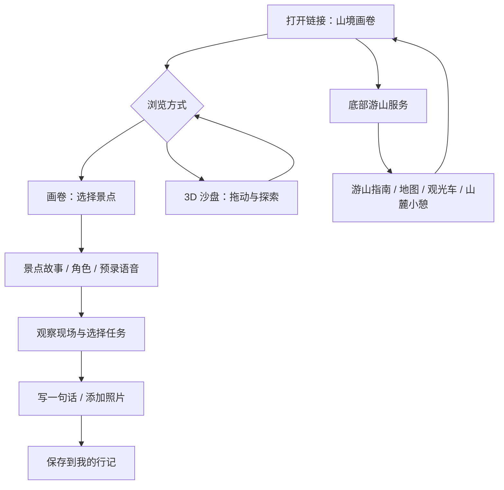
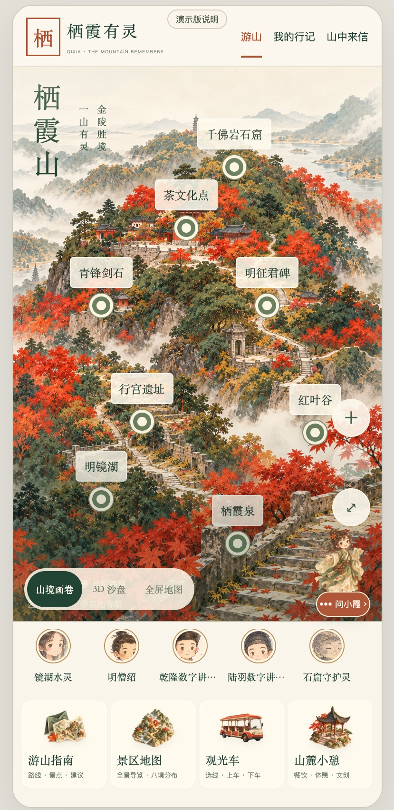
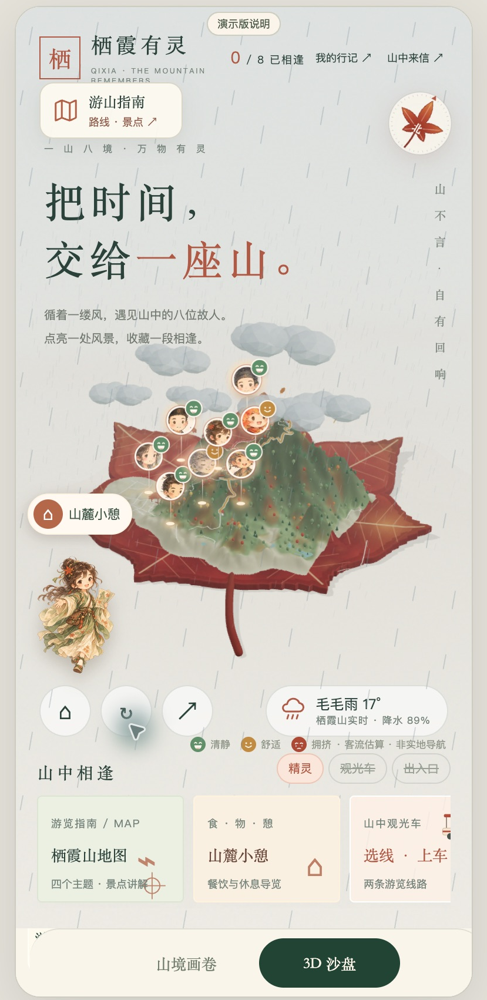
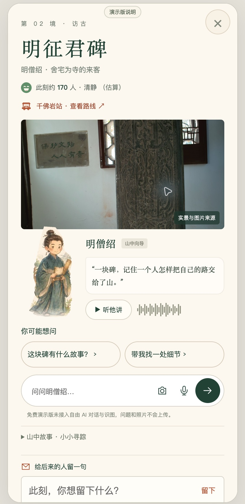

# 栖霞有灵｜产品需求文档

| 项目 | 内容 |
| --- | --- |
| 版本 | V1.0 产品原型与公开演示版 |
| 更新日期 | 2026-10-31 |
| 产品形态 | 手机优先的 Web 产品，桌面端提供手机预览 |
| 核心主题 | 一山八境，文化探索与旅行记忆 |
| 本次基线 | 山境画卷 / 3D 沙盘双入口、底部四张服务卡片、可往返切换 |
| 交付范围 | 可访问静态演示、完整源码、PRD、真实界面截图、部署说明 |

## 1. 产品定位

栖霞有灵把景点浏览、人物讲解、行程参考和个人记录放在同一条游山体验中。用户先用画卷或沙盘认识山的结构，再选择感兴趣的景点，读故事、听预录讲解，最后留下自己的观察。

产品不承担实地精确导航、官方运营公告或紧急救援职责。当前版本是可交互原型，并非景区正式上线系统。

### 1.1 要解决的问题

以下为产品设计假设，尚不代表已完成访谈验证：

1. 首次到访者面对分散的景点与历史资料，不容易判断“从哪里开始、看什么”。
2. 传统讲解侧重知识罗列，用户与景点之间缺少可观察、可参与的连接。
3. 路线、交通、地图和休息服务入口分散，影响现场查找效率。
4. 游览照片和感受难以与具体景点关联，回看时缺少上下文。

### 1.2 产品价值

- 用画卷建立情绪与文化氛围，用 3D 沙盘帮助理解整体空间。
- 每个景点提供角色、故事和观察线索，支持不同深度的探索。
- 用统一的四个服务入口降低找信息的成本。
- 让一句话或一张照片成为可以回看的个人游览记忆。

## 2. 用户与场景

| 用户 | 场景 | 主要诉求 | 当前承接 |
| --- | --- | --- | --- |
| 首次到访者 | 出发前、入口处 | 快速认识景点与路线 | 画卷、3D、游山指南 |
| 亲子 / 家庭游客 | 边走边停 | 易理解的故事、休息与交通参考 | 角色讲解、家庭路线、服务入口 |
| 文化兴趣游客 | 碑刻、遗址、石窟前 | 理解背景、查看来源 | 八景内容、讲解书、观察任务 |
| 拍照与轻旅行用户 | 风景点停留 | 记录当下与回看 | 照片、山中来信、我的行记 |
| 展示体验者 | 演示链接、比赛展台 | 在短时间内理解产品 | 无需登录浏览、视图切换、预置内容 |

实际游客需求、路线时长、无障碍情况与内容有效性，需要通过访谈和现场核验进一步确认。

## 3. 用户主流程

### 3.1 必须成立的切换规则

- 首次访问显示山境画卷，不能自动跳入备份沙盘。
- “山境画卷”与“3D 沙盘”是同一产品的两个入口，不能成为无法返回的独立页面。
- 进入 3D 后，底部仍可见两个切换按钮；选中态与实际内容一致。
- 切回画卷后恢复原产品的景点与服务入口，不能留下遮罩拦截点击。
- 备份沙盘以独立文档复用原版布局；模式导航由外层产品控制。
- 重复切换不重复创建 iframe，不叠加事件监听，不清空个人行记。

## 4. 信息架构

| 层级 | 内容 |
| --- | --- |
| 首页 | 品牌、画卷 / 3D 切换、八景选择、小霞入口 |
| 景点页 | 景点名称、角色、故事、观察任务、照片与来源、讲解入口 |
| 底部服务 | 游山指南、景区地图、观光车、山麓小憩 |
| 游山指南 | 同行方式、参考路线、景区讲解书 |
| 个人记录 | 山中来信、我的行记、保存与删除 |
| 演示说明 | 当前能力、数据性质、存储范围、服务器功能边界 |

### 4.1 八个景点与角色

| 景点 | 角色 / 叙事线索 | 体验重点 |
| --- | --- | --- |
| 明镜湖 | 镜湖水灵 | 湖面、亭桥与倒影 |
| 明征君碑 | 明僧绍 | 碑刻、历史与山林 |
| 行宫遗址 | 乾隆数字讲述者 | 遗址与行旅记忆 |
| 茶文化点 | 陆羽数字讲述者 | 茶事与文化联想 |
| 千佛岩石窟 | 石窟守护灵 | 石刻、造像与光影 |
| 青锋剑石 | 山石地质灵 | 纹理、地质与传说 |
| 红叶谷 | 枫叶精灵 | 叶色与秋日观察 |
| 栖霞泉 | 泉灵 / 山灵 | 水声与环境观察 |

数字角色不代表真实历史人物在现场与游客交流，故事应区分资料事实、地方传说和艺术演绎。

## 5. 功能需求与验收

### F01｜山境画卷（P0）

画卷是默认首页。用户可以查看景点标记、缩放画卷、进入景点内容，也能使用全屏地图入口。

**验收：** 首屏出现画卷；点击八个景点分别打开对应内容；关闭后回到画卷；缩放操作不触发错误的景点点击；关键控件在手机宽度下可点击。

### F02｜3D 沙盘（P0）

使用主题改版前备份中的地形与完整沙盘界面。保留旋转、缩放、回到全景及原版景点、交通演示交互，不改造成一张模拟旋转的图片。

**验收：** 只有点击 3D 入口才加载沙盘；山体可旋转与缩放；底部两个模式按钮始终能返回画卷；连续往返三次无导航锁死；旧版资源不会覆盖画卷样式。

### F03｜八景故事与角色讲解（P0）

展示景点名称、角色、说明、观察线索与来源。提供本地预录语音。用户可停止或切换讲解；更换景点时避免多段音频同时播放。

**验收：** 八景内容对应正确；音频失败时保留可阅读文字；资料引用与数字演绎有区分；页面不以未核验资料承诺真实开放情况。

### F04｜底部四个服务入口（P0）

四个入口采用插画卡片，放在页面下方、角色栏之后。包括游山指南、景区地图、观光车和山麓小憩。不能移动到画卷右上角压住风景。

**验收：** 四张卡片排列清晰，图、标题和说明可见；各卡片进入对应功能；关闭服务内容后能继续浏览；手机竖屏不产生横向页面溢出。

### F05｜游山指南与讲解书（P0）

按单人、情侣、家庭、朋友等同行方式提供参考路线。景区讲解书支持景点章节与资料查看；静态版通过本地内容读取，避免依赖服务器才能阅读。

**验收：** 同行方式切换可用；章节打开、返回与搜索可用；路线里程、时间及插画清楚标注为参考或示意；不把参考路线描述为已完成的实时导航。

### F06｜小霞旅行伙伴（P1）

小霞作为持续可见的角色入口，可拖动到合适位置。提供欢迎语音、景点故事和服务入口。完整后端版本支持文本、图片和语音提问。

**免费版边界：** 自由 AI 对话、图片理解与生成语音不接入；应清楚说明，不能返回假装由模型生成的回答。

### F07｜山中来信与我的行记（P0）

用户选择景点、填写一句话、可选照片，再保存或删除。免费版只保存在当前浏览器，不支持跨用户共享。完整后端版本使用个人凭证和 SQLite 存储，公共内容需审核。

**验收：** 私密保存后能在“我的行记”读取；刷新后仍存在；删除后不再展示；存储失败不能显示成功；免费版公开发布明确提示未开放；清除浏览器数据会丢失的事实可见。

### F08｜观光车与客流（P1）

提供站点、线路和跟车演示；客流与车次为示意 / 估算。原型包含司机定位与车辆接口，但在线静态版本不提供实时车辆上报。

**验收：** 示意车辆可体验；无后端数据时不伪装成真实 GPS；真实运营时间、排队、车位以景区现场信息为准。

### F09｜照片与纪念海报（P2）

照片可以用于个人记录。图片理解和 AI 海报由后端调用模型，属于完整服务的可选能力；免费静态版显示清晰的未接入说明，不上传照片到外部模型。

## 6. 界面与交互原则

- 延续秋日山水、米白纸感、深绿文字与枫红强调色。
- 画卷提供沉浸式浏览，服务入口集中在下方；导航不压住核心画面。
- 旧版沙盘保留自己的布局，外层模式导航保持一致。
- 控件具有可读名称、焦点样式和适当触控面积；图像提供替代说明。
- 请求中、空内容、失败、保存成功和未开放功能必须有不同反馈。
- 不在游客界面展示 API 密钥、内部模型参数或开发调试信息。

## 7. 数据与隐私

| 数据 | 免费版 | 完整后端原型 |
| --- | --- | --- |
| 景点知识、图像、预录语音 | 随静态资源发布 | 同左 |
| 已访问景点、部分界面状态 | 浏览器存储 | 浏览器存储 |
| 私密来信 / 照片 | 当前浏览器 localStorage | SQLite + 个人凭证 |
| 公共来信 | 不开放 | 待审核 / 通过 / 驳回状态 |
| 自由对话与图片理解 | 不发送至模型 | 服务器代理调用模型 |
| 司机位置 | 不提供实时数据 | 需权限、HTTPS 与接口接入 |

公开部署不包含本机密钥、证书和已有游客数据库。后续正式服务必须补充账户恢复、管理员权限、内容审核、接口限流、数据保留与删除策略。当前个人凭证方案不能等同于正式账号体系。

## 8. 技术实现

- 原生 HTML / CSS / JavaScript，多页面与模块脚本组合。
- Three.js 与 OrbitControls 本地加载，避免核心 3D 依赖外部 CDN。
- 手机预览容器承载应用；独立 iframe 承载旧版沙盘，外层控制模式切换。
- 本地知识与媒体资源支撑静态浏览；Node.js 原型服务提供可选 API。
- 免费公开版部署为静态文件，使用演示适配明确处理服务端功能。
- 地图与地形数据来源、第三方组件和素材许可记录保留在仓库中。

## 9. 非功能要求

以下为待系统测试的验收目标，不代表已测得的指标：

| 项目 | 目标 |
| --- | --- |
| 兼容性 | 覆盖当前主流手机浏览器与桌面 Edge / Chrome |
| 响应布局 | 竖屏主流程完整；横屏无关键按钮遮挡 |
| 首屏 | 优先加载画卷，3D iframe 按需加载 |
| 弱网 | 本地知识可回退；加载失败给出明确说明 |
| 内容可信度 | 官方事实、传说、AI 艺术示意分别标注 |
| 可访问性 | 关键控件可聚焦、可辨认，图片含替代文本 |
| 安全 | 公共代码不含密钥、数据库或私钥 |
| 可维护性 | 视图、内容、服务与部署边界在文档中可追踪 |

## 10. 指标与验证计划

尚未接入正式分析系统，也没有真实业务增长数据。建议试用阶段统计：首次景点打开率、画卷与 3D 往返成功率、故事完成率、服务入口点击率、来信保存成功率、任务失败率和用户主观可用性反馈。采集前明确用途与范围，优先采用匿名、最小化数据。

首轮用户测试建议覆盖首次到访者、家庭游客与文化兴趣用户，观察他们能否独立完成“选景点—读故事—查看服务—保存行记—返回首页”。不要用演示点击次数替代真实用户价值验证。

## 11. 版本规划

| 阶段 | 内容 | 完成标准 |
| --- | --- | --- |
| 当前演示版 | 双视图、八景、底部服务、本地行记、文档和截图 | 主要流程可访问、可返回，边界说明准确 |
| 服务试用版 | 稳定后端、模型配置、鉴权、审核、监控 | 保存与权限测试、费用和错误处理验证 |
| 景区试点 | 实地内容核验、路线开放核验、运营数据对接 | 景区确认内容与服务口径，完成真实游客测试 |
| 后续探索 | 个人精灵、跨游客回应、多语言、AR | 有用户需求证据和可维护的数据流程后再扩展 |

## 12. 已知限制

1. 免费 GitHub Pages 是静态站点，不能运行 Node.js 后端或承诺国内所有网络稳定直连。
2. 画卷与沙盘是艺术化探索视图，不提供精确导航或安全路径保证。
3. 客流、车位、车次与部分路线用时是示意或估算，不是实时官方数据。
4. 两种视图复用不同历史版本的 UI，个别角色与服务布局存在差异。
5. 当前没有正式用户账户恢复、跨设备同步或已上线的公共内容审核运营。
6. AI 能力的完整体验需要有效模型服务、额度、HTTPS 与后端部署。

## 13. 交付截图

### 首页与底部服务

### 3D 沙盘与双入口

### 景点故事

这些截图用于展示实际产品状态，不表示景区实拍画面，也不构成对实时服务的承诺。
